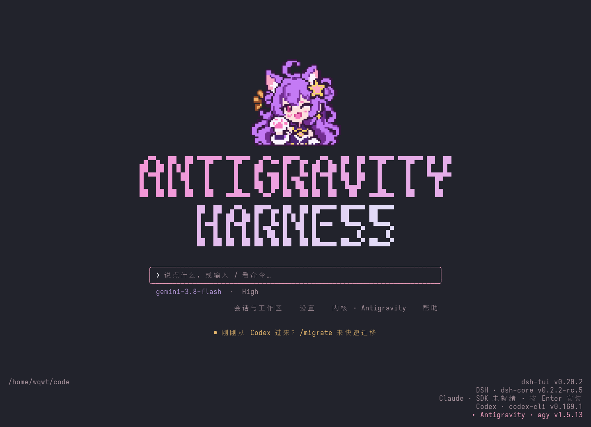

# dsh-tui-antigravity

在 dsh-tui 的终端界面中使用本机 Antigravity CLI。可以复用 Google 登录、用 `/usage` 看配额、审批工具调用，并在 dsh-tui 与官方 agy 之间续聊同一段历史。本项目由社区维护。



## 安装

首版验收环境为 WSL、dsh-tui 0.20.2、dsh 0.2.2-rc.5 和 agy 1.5.13。先确保当前终端能运行 `dsh-tui`、`dsh`、`pnpm` 和 `agy acp --help`。Node.js 版本遵循 dsh-tui 的要求。首次使用 dsh-tui，请先单独启动一次，完成宿主初始化后退出。

```sh
dsh plugin --profile dsh-tui add dsh-tui-antigravity
dsh-tui --backend antigravity
```

npm 渠道从 v0.1.1 开始提供。需要固定版本时，在包名后加 `@0.1.1`。也可把 [GitHub Release](https://github.com/wuqiuwangtian/dsh-tui-antigravity/releases) 中对应版本的 `.tgz` 下载链接传给同一条 add 命令。已发布的 [v0.1.0 安装说明](https://github.com/wuqiuwangtian/dsh-tui-antigravity/blob/v0.1.0/README.md) 仍可使用。

已登录 agy 的用户可以直接发送第一句话，随后输入 `/usage` 检查配额。首次登录时输入 `/login`，按提示完成 Google 授权，回到 TUI 输入 `/new`。浏览器未弹出时，登录页提供打开和复制链接入口。后续也可从启动页或 `/kernel` 选择 Antigravity。

## 体验 main 上的改动

npm 的 `0.1.1` 对应已发布版本。要体验以下功能，可以从当前源码安装：

```sh
git clone https://github.com/wuqiuwangtian/dsh-tui-antigravity.git
cd dsh-tui-antigravity
npm ci
dsh plugin --profile dsh-tui add "$PWD"
dsh-tui --backend antigravity
```

- **看配额**：输入 `/usage` 或 `/quota`，结果直接显示在聊天记录里。同一会话在 60 秒内可复用上次的结果；输入 `/usage refresh` 可立即重新查询。首次查询耗时取决于 agy 返回实时配额的速度。
- **边访谈边做计划**：输入 `/plan /grill-me 为新用户设计欢迎页`。agy 会提问并根据回答生成待审阅的计划。访谈中可以选推荐项，也可以填写自己的答案。
- **查原生命令**：`/agy commands` 列出当前会话可用的命令。宿主有同名命令时，可用 `/agy hooks` 等形式指定 agy。长报告在末尾显示翻页命令。

## 启用配套启动页

退出 dsh-tui 后，在 WSL 中运行以下命令。需要 Git。脚本把配色、像素标题和吉祥物应用到当前 profile 的宿主；品牌设置选择「跟随后端」即可看到效果。

```sh
plugin_dir="${DSH_HOME:-$HOME/.dsh}/profiles/dsh-tui/node_modules/dsh-tui-antigravity"
sh "$plugin_dir/ui/brand.sh"
dsh-tui --backend antigravity
```

UI 补丁适配 dsh-tui 0.20.2。其他版本可先使用默认界面。重装同一版宿主后可重新应用；升级宿主前建议先撤销补丁。

## 内核快捷切换与会话删除指引

当前开发版包含一份适用于 dsh-tui 0.20.2 的可选补丁。安装当前源码版插件后，可单独启用这两项交互（独立于启动页配色）。在 WSL 中运行以下命令，然后重新打开 dsh-tui。

```sh
sh "${DSH_HOME:-$HOME/.dsh}/profiles/dsh-tui/node_modules/dsh-tui-antigravity/ui/kernel-shortcuts.sh"
```

在启动页或聊天框输入 `/ant`，选中 `/antigravity` 后按 Tab 补全、回车切换。也可直接输入 `/Antigravity`。在 Antigravity 中，`/agy` 打开功能面板。在 `/resume` 的会话列表中选中一条对话并按 Ctrl+D，可查看官方 agy 的删除步骤。撤销宿主补丁时，给上面的脚本加 `remove` 参数。

## 卸载

如已应用宿主补丁，先退出 dsh-tui，分别撤销已安装的快捷命令补丁和启动页补丁，再卸载插件。

```sh
plugin_dir="${DSH_HOME:-$HOME/.dsh}/profiles/dsh-tui/node_modules/dsh-tui-antigravity"
# 按已安装的补丁执行对应的撤销命令
sh "$plugin_dir/ui/kernel-shortcuts.sh" remove
sh "$plugin_dir/ui/brand.sh" remove
dsh plugin --profile dsh-tui remove dsh-tui-antigravity
```

## 使用与反馈

- 用 `/agy` 打开 Antigravity 功能菜单，使用 `dsh-tui --backend antigravity --resume <id>` 恢复会话。可通过 `ANTIGRAVITY_EXECUTABLE` 指定 agy 的绝对路径。
- 原生会话改名、分叉和删除等操作仍需在官方 CLI 中完成。Windows 原生和 macOS 端到端流程、两个真实 Google 账号切换尚待实测。详见[功能与限制](docs/usage.md)和[验收记录](docs/verification.md)。
- [提交问题](https://github.com/wuqiuwangtian/dsh-tui-antigravity/issues)时请附系统、终端、dsh-tui 和 agy 的版本，以及出现问题的步骤。贴日志前请删去授权链接、令牌、账号和私有路径。

插件代码采用 [MIT](LICENSE) 许可。启动页吉祥物参考社区流传的猫娘形象，经 AI 辅助生成并制作为像素立绘。素材来源说明与宿主补丁的上游版权条款见[第三方声明](THIRD-PARTY-NOTICES.md)。

## 兼容性

| 组件 | 已验证版本 | 验证范围 |
| --- | --- | --- |
| dsh-tui 后端 | 0.20.2 | WSL 真实对话、配额、审批、历史恢复 |
| 可选启动页 | 0.20.2 | 图片与字符回退、80×24 布局及补丁撤销 |
| 可选快捷命令补丁 | 0.20.2 | Tab 补全、与 Codex 双向切换、会话删除指引及补丁撤销 |
| agy | 1.5.14 | 实测配额查询与缓存、配置编辑、原生访谈和计划产物；[逐项验收记录](docs/verification.md) |
| agy | 1.5.13 | ACP、登录、模型、配额与原生会话；详细边界见使用手册 |

[上游兼容检查](https://github.com/wuqiuwangtian/dsh-tui-antigravity/actions/workflows/compat.yml) 每天检查 npm 上的 dsh-tui 稳定版和 agy 官方 Linux 版本。新版本在 CI 中分别检查后端、启动页和无账号 ACP 握手；真实账号验收及更新上表由维护者完成。[启动页插件接口讨论](https://github.com/ccch1mneyyy/dsh-TUI/discussions/2069)
